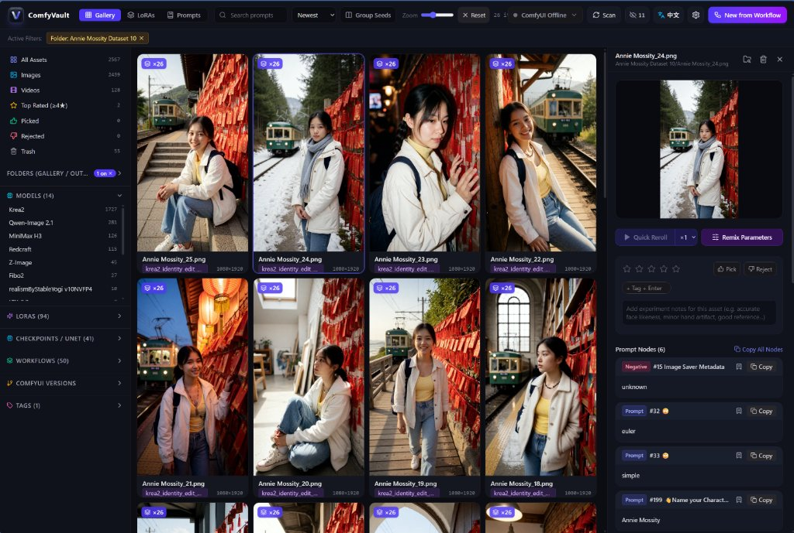

<div align="center">

# ComfyVault `v0.1.26`

**A Local Asset Manager, Parameter Tracker, Workflow Launcher & Non-Destructive Remix Studio for ComfyUI**

 

[English](README.md) · [简体中文](README_ZH.md)

<br/>



</div>

---

## What is ComfyVault?

**ComfyVault** is a fast, local-first web studio built alongside ComfyUI (`http://127.0.0.1:8189`). It turns your ComfyUI `output/` folders (and any number of additional local image/video archive folders) into a searchable, 60fps visual library — while giving you full parameter inspection, non-destructive remixing, LoRA weight analytics, direct workflow launching, and AI-powered prompt conversion.

## Key Features

### 1. High-Speed Multi-Folder Asset Library
- **Multiple Output / Gallery Directories**: Configure `ComfyUI/output` plus any number of external archive/album folders in Settings. Incremental scanning & `watchdog` live file monitoring index new generations automatically.
- **60fps Virtualized Masonry**: Handles thousands of PNG/WebP/JPG images and MP4/WebM videos smoothly with background WebP thumbnail pre-warming, hover video preview, marquee drag-selection, per-asset hide/unhide, and batch tagging/starring/trash (safely sent to OS Recycle Bin).
- **WebGL2 Hardware-Accelerated Lightbox**: Picasa-style smooth darkroom viewer with anchor-locked zoom up to 400%, double-click 100%/fit toggle, drag pan, and silky 3D flip/rotate (`Q`/`E`/`H`/`V`) with lossless PNG metadata-preserving auto-save.
- **Smart Faceted Filtering**: Filter by physical directory tree, foundation model family (Krea2, Qwen-Image, MOSS, MiniMax H3, Flux.2, Wan 2.2, LTX-2.3, etc.), LoRA, checkpoint, workflow fingerprint, ComfyUI git version, star rating, pick/reject flags, and custom tags.
- **Seed Recipe Grouping & A/B Visual Diff**: Collapse seed variations of the same prompt/params into a single card, or select any two assets for split-slider A/B visual + prompt/LoRA/parameter comparison.

### 2. Workflow Launcher & Full Node Editor
- **Direct Workflow Creation**: Point ComfyVault to one or more local `.json` workflow directories (supports both ComfyUI UI and API JSON formats, even while ComfyUI is offline). Pin frequently used workflows and pin frequently edited nodes inside each workflow.
- **Full Editable Node Forms**: Numerically sorted `#node_id` cards with `LoadImage` thumbnail previews & direct upload to ComfyUI, plus an interactive **Power LoRA Editor** (add, delete, reorder, toggle, `0.01`-precision weight slider, and auto-detected per-LoRA min/max limits from `.civitai.info`, `.metadata.json`, `.rgthree-info.json`, and usage history).
- **Save Back to Workflow**: Save edited parameters & prompts back into workflow files atomically without closing the modal.

### 3. Non-Destructive Remix & Live ComfyUI Bridge
- **One-Click Reroll & Remix**: Open any indexed asset in the Remix modal (with workflow name, `#hash`, and base model in the header) to tweak prompts, LoRAs, or any node parameter and queue directly to ComfyUI while keeping original files intact.
- **Live Execution Progress & Service Control**: Real-time WebSocket progress bar showing current executing node title & step count, interrupt button, automatic `--port` detection from `run_nvidia_gpu.bat`, and Start / Stop / Restart controls for ComfyUI.

### 4. Prompt Snippets & AI Prompt Converter (Gemini / ChatGPT Web)
- **Reusable Snippet Library**: Save and categorize reusable prompt blocks and insert them into any prompt editor with one click.
- **AI Prompt Converter**: Turn any existing asset prompt or a single-sentence idea into structured, model-adapted paragraphs (Krea2, MOSS, Qwen-Image, MiniMax H3, Wan, Flux, etc.) using your own **Gemini** or **ChatGPT** web membership via a persistent local browser profile.
- **Character-Locked Template (`------`) Awareness**: Automatically detects workflows with a `------` divider line, keeps your fixed character trigger block above the divider untouched, and generates only scene/hair/wardrobe/pose/expression/lighting/story paragraphs (excluding facial features, body proportions, and aspect ratio), then pre-fills the workflow creation modal ready to run.

### 5. Bilingual UI, Themes & Windows System Tray Launcher
- **Instant ZH / EN Switching**: One-click language toggle in the top navigation bar, Settings, and the Windows System Tray Launcher.
- **Dark / Light Theme & 4-Level Global Font Scaling**.
- **Windows Tray Launcher (`launcher/ComfyUILauncher.cs`)**: Single-click bilingual tray app with independent submenus to **Open / Start / Restart / Stop** both **ComfyVault (8189)** and **ComfyUI** (auto-detects custom `--port`).

---

## Installation Guide

> **No Node.js required for normal use!** The compiled frontend (`frontend/dist`) is included in the repository so you can run ComfyVault immediately with Python.

### Prerequisites
- An existing **ComfyUI** installation (Python 3.10–3.12; battle-tested on `ComfyUI_windows_portable`)
- **Git** (or download the repository as a `.zip` from GitHub)
- **Microsoft Edge** or **Google Chrome** *(optional — only needed if you use the Gemini/ChatGPT web prompt converter)*

---

### Option A: ComfyUI Windows Portable (Recommended)

#### 1. Clone ComfyVault into your `ComfyUI_windows_portable` root folder
Open PowerShell inside `ComfyUI_windows_portable\` so the folder layout looks like this:

```text
ComfyUI_windows_portable/
├── ComfyUI/
├── python_embeded/
├── run_nvidia_gpu.bat
└── ComfyVault/          <-- clone here
```

```powershell
git clone https://github.com/BeckMint/comfyvault.git ComfyVault
```

#### 2. Install Python dependencies (using ComfyUI's embedded Python)
```powershell
.\python_embeded\python.exe -m pip install aiohttp watchdog pillow pyyaml
```

*(Optional — only if you want to use the Gemini / ChatGPT web prompt converter:)*
```powershell
.\python_embeded\python.exe -m pip install playwright
```

#### 3. Launch ComfyVault
```powershell
cd ComfyVault
..\python_embeded\python.exe -s run_vault.py
```
*(You can also double-click `ComfyVault\start_vault.bat`.)*

Then open **`http://127.0.0.1:8189/`** in your browser!
ComfyVault will automatically scan `ComfyUI/output` and `ComfyUI/user/default/workflows`. You can add extra gallery/workflow folders anytime in **Settings (gear icon)**.

---

### Option B: Standard Python venv / Linux / macOS

#### 1. Clone ComfyVault alongside your `ComfyUI/` directory
```bash
git clone https://github.com/BeckMint/comfyvault.git ComfyVault
```

#### 2. Activate your ComfyUI Python environment and install dependencies
```bash
pip install aiohttp watchdog pillow pyyaml
# Optional: for Gemini / ChatGPT web prompt converter
# pip install playwright
```

#### 3. Run ComfyVault
```bash
cd ComfyVault
python run_vault.py
```

Open **`http://127.0.0.1:8189/`** in your browser. If your ComfyUI installation lives in a different path, open **Settings (gear icon)** to point ComfyVault to your output and workflow directories.

---

### Updating ComfyVault
```bash
cd ComfyVault
git pull
```
Then restart ComfyVault (`run_vault.py`).

### Optional: Compile the Windows System Tray Launcher (Bilingual ZH / EN)
Run from inside the `ComfyVault\` directory (uses the built-in Windows .NET Framework compiler, no Visual Studio required):

```powershell
C:\Windows\Microsoft.NET\Framework64\v4.0.30319\csc.exe `
  /nologo /target:winexe /utf8output `
  /out:..\ComfyUI启动器.exe `
  /r:System.Windows.Forms.dll /r:System.Drawing.dll `
  /win32icon:launcher\app.ico `
  launcher\ComfyUILauncher.cs
```
The tray launcher automatically detects your Windows UI language (Chinese or English) and lets you toggle languages anytime from its right-click menu.

### Optional: Rebuilding the Frontend (For Developers)
Only needed if you modify files under `frontend/src/` (requires Node.js 18+):
```bash
cd ComfyVault/frontend
npm install
npm run build
```

---

## Configuration & Environment Variables

| Variable | Default | Description |
|---|---|---|
| `COMFYVAULT_HOST` | `127.0.0.1` | Host interface for ComfyVault server |
| `COMFYVAULT_PORT` | `8189` | Port for ComfyVault Web UI |
| `COMFYUI_HOST` | `127.0.0.1` | ComfyUI server host |
| `COMFYUI_PORT` | `8188` *(auto-detected)* | ComfyUI server port (automatically detects `--port <N>` in `run_nvidia_gpu.bat` if present) |

In the Web UI, click the **Settings (gear icon)** in the top bar to configure:
- **Interface Language** (中文 / English), **Theme** (Dark / Light), and **Font Scale**
- **Output / Gallery Directories** (add multiple local image/video folders)
- **Workflow Directories** (add multiple `.json` workflow folders)

---

## Privacy & Security Notes
- Everything runs **100% locally** (`127.0.0.1`).
- Your SQLite index (`data/vault.db`), cached WebP thumbnails (`data/thumbs/`), launcher preferences (`data/launcher_lang.txt`), and optional browser login profile (`data/web_llm_profile/`) stay exclusively inside `ComfyVault/data/` and are ignored by `.gitignore`.

## License
Released under the [MIT License](LICENSE).
