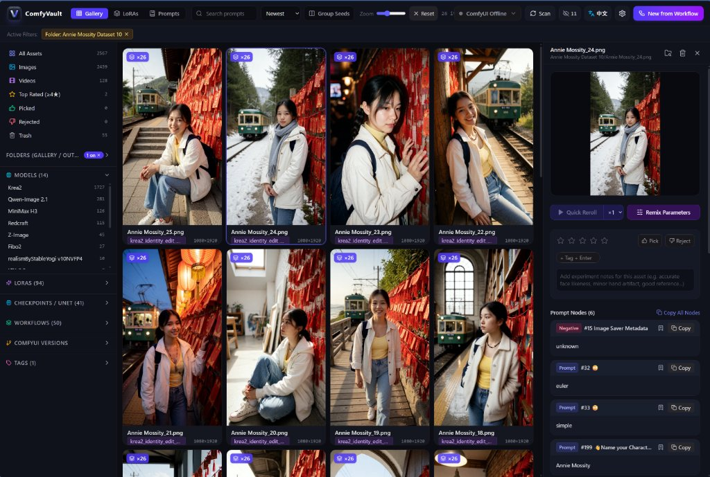

<div align="center">

# ComfyVault `v0.1.61`

**面向 ComfyUI 的一站式本地创作工作台：虚拟滚动资产库 · 三引擎 AI 看图反推与写词 · 多参考图宫格对比 · 可视化工作流启动台 · 实时显存/内存异常告警**

   

[English](README.md) · [简体中文](README_ZH.md)

<br/>



</div>

---

## 为什么做 ComfyVault？

ComfyUI 用久了，`output/` 动辄几千张图和视频、`workflows/` 堆满几百个长文件名 JSON，找参数、复现效果、做风格对比、盯长视频防爆内存都很折腾。**ComfyVault** 运行在本地 `http://127.0.0.1:8189`，不依赖任何云服务，把 ComfyUI 打造成真正顺手的本地创作工作室：

| ComfyUI 高频痛点 | ComfyVault 的解决方案 |
|---|---|
| **`output/` 堆满成千上万张图和视频，翻找参数太痛苦** | 流畅虚拟滚动相册（WebP 缩略图缓存），内置 **PyAV** 视频元数据直读与完整性校验，支持模型/LoRA/提示词/版本/标签多维筛选与同配方折叠。 |
| **几百个纯文字 `.json` 工作流，找半天还容易点错** | 工作流列表支持**自定义方形头像 Icon（拖拽 / 上传 / `Ctrl+V` 粘贴）**、工作流置顶、常用节点置顶，并自动记住每个工作流拉过的提示词框高度。 |
| **看图反推总把自己的角色 LoRA 脸型身材带偏，机位姿势还原差** | **三引擎 AI 反推/转换**（Gemini 网页版 / ChatGPT 网页版 / **本地离线无审核 Qwen3-VL**），支持 `------` 角色锁定模板、首句机位透视锁死、姿势/表情/投射光影强化，并自动对齐工作流画幅。 |
| **反推生图或画风迁移/图生图后，不好直观对比原图效果** | **一键原图对比**：自动识别反推参考图与工作流内所有 `LoadImage` 输入图——**单张左右分屏/滑块叠加，多张自动 N 宫格排列（成品图在最后一格）**。 |
| **跑视频工作流悄悄爆内存换页，一卡卡几小时没人提醒** | **实时显存 / 内存 / 单步卡顿监控**：异常时在进度条正上方弹出高亮警示栏并支持一键终止；进度条中断按钮左移并带 **3 秒二次防误触确认**。 |

---

## 核心亮点功能

### 1. 三引擎 AI 看图反推 & 每个提示词框内置「AI 写提示词」
- **三引擎自由切换，无需额外买 API**：
  - **Gemini 网页版 / ChatGPT 网页版**：复用你现有的网页端会员，本地独立浏览器登录态持久化，单对话自动复用并带每轮唯一标记防串词。
  - **本地 Qwen3-VL（100% 离线无审核）**：直连 ComfyUI 本地 `AILab_QwenVL_Advanced` 节点离线推理，跑完自动释放显存。
- **高还原度看图反推**：支持拖拽、上传或 `Ctrl+V` 粘贴参考图；反推规则强制在首句锁死**俯拍/仰拍/视角透视**，精准拆解**四肢姿势锚点、抗 LoRA 覆盖的表情细节、高调/低调光影与花纹投影落点**，并**自动把工作流的分辨率/比例节点对齐到参考图画幅**。
- **固定角色模板（`------`）智能保护**：自动识别主提示词框中的 `------` 分隔线，保留上方固定角色触发词不变，仅生成下方场景/动作/服装/光影段落（自动过滤五官身材描述、画幅词及原图水印/`@账号`）。
- **每个提示词框内置「AI 写提示词」**：在*创建工作流*与*微调派生*的每一个提示词输入框右上角都内置 `AI 写提示词` 按钮，自动识别当前工作流所用**底模**（Krea2、Qwen-Image、MOSS、MiniMax H3、Wan 2.2、LTX-2.3、Flux.2、SDXL 等）与**图片/视频类型**，带实时进度条与独立结果框供一键复制或直接填入。

### 2. 参考原图 vs 生成成品：单张分屏 & 多张 N 宫格对比
- **双来源自动识别**：同时兼容 **AI 看图反推参考图** 与 **工作流内所有 `LoadImage` 节点输入图**（画风转换、图生图、图生视频、ControlNet、多图参考编辑等，历史已生成的作品也会自动识别生效）。
- **智能自适应排版**：
  - **1 张参考图**：默认进入 **左右分屏对比**，支持切换 **滑块叠加** 与 **100% 原图滚动**。
  - **2 张及以上参考图**：默认进入 **N 宫格对比**，按工作流节点顺序从 **参考图 1 → 参考图 2 → … → 成品图（最后一格高亮展示）** 排列，也可随时切到 1v1 细看单张参考图。
- 在瀑布流卡片左上角（悬停展开图标）、右侧详情栏（带多图缩略预览）及全屏灯箱中均可一键打开对比。

### 3. 可视化工作流启动台、自定义工作流图标 & 节点编辑器
- **自定义工作流图标**：点击工作流列表左侧的 `36×36` 图标位即可弹窗设置专属头像，支持 **拖拽、点击上传、`Ctrl+V` 直接粘贴**，自动居中裁切为 `160×160` WebP 持久化保存，在*创建*与*转换*两个列表实时互通显示。
- **完整可编辑节点表单（离线也能改）**：扫描多个 `.json` 工作流目录（兼容 UI/API 格式及 ComfyUI V3 动态节点），支持工作流置顶与单工作流内常用节点独立置顶。
- **提示词框高度记忆**：拉高任意提示词输入框后，自动按「工作流 + 节点 + 字段」记住高度，下次打开自动恢复。
- **Power LoRA 可视化编辑器**：支持增删、排序、开关、`0.01` 精度权重滑块，并自动从 `.civitai.info` / `.metadata.json` / `.rgthree-info.json` 与历史记录读取每张 LoRA 的推荐上下限。
- **原地保存**：修改后的提示词、LoRA 与参数可一键原子写回原 `.json` 工作流文件，无需关闭弹窗。

### 4. 实时资源监控、异常高亮告警 & 精确生成耗时
- **执行期实时体检**：工作流运行时每 2.5 秒实时采集 **Windows 系统内存（RAM）、虚拟内存提交（Commit）、GPU 显存（VRAM）与采样单步耗时**，进度条右侧实时显示 `VRAM % · RAM %` 徽章。
- **进度条上方高亮警示栏**：一旦检测到内存告急（`≥ 85% / 92%`）、显存+内存双重满载或单步严重卡顿（`≥ 90s / 180s`），立刻在进度条正上方弹出**琥珀色预警 / 红色危险告警**，说明具体原因并提供 **`终止当前任务`** 与 **`继续观察`** 选项。
- **防误触中断设计**：进度条的 **`中断`** 按钮放在左侧（彻底远离右上角高频 **`创建`** 按钮），且需 **3 秒内二次点击确认**（`中断` → `确认中断?`），手滑再也不会误杀跑了十几分钟的视频任务。
- **精确生成耗时与视频时长分离展示**：直接从 ComfyUI `/history` 提取毫秒级 `execution_start → execution_success` 耗时（重启与重扫均不丢失），在详情栏同时展示 **`生成耗时`**（如 `18分53秒`）与 **`视频时长`**（如 `10.12s (24fps)`）。

### 5. 虚拟滚动视频友好相册、PyAV 元数据直读 & WebGL2 暗房看图
- **视频体验全面优化**：列表视频卡片居中放置 **播放 / 暂停** 按钮（点到卡片其他区域仅选中不播放）；右栏预览禁止自动播放；**全站所有视频统一只播一次不循环**；任意弹窗打开或切换播放时自动暂停其余视频，绝不出现两个视频同时出声。
- **防半成品入库与 PyAV 直读**：内置 PyAV 直读 MP4/WebM 分辨率、帧率、时长与内嵌 `prompt/workflow` 元数据，并校验视频流完整性，彻底杜绝 `48 B` 半成品视频或 `512×512` 占位图入库。
- **WebGL2 硬件加速灯箱**：暗房级平滑缩放（最高 400% 锚点锁定）、拖拽平移、丝滑 3D 旋转/镜像翻转（`Q`/`E`/`H`/`V`）并无损保留 PNG 元数据自动写回。
- **多维筛选、同配方折叠 & A/B Diff**：按文件夹树、模型族、LoRA、底模、工作流指纹、ComfyUI 版本、星级、精选/废片与标签筛选；折叠同配方不同 Seed 抽卡结果；勾选两张图进行卷帘滑块对比及提示词/LoRA/参数 Diff。

### 6. 无损微调派生、双语主题 & Windows 系统托盘启动器
- **一键重摇（Reroll）与无损微调（Remix）**：基于任意历史图片或视频直接改词/改 LoRA/改参数派生新图，自动保留父子谱系与参考原图关联（持久化落盘，重启不丢）。
- **中英文即时切换**、深浅色主题与 4 档全局字号缩放。
- **Windows 系统托盘启动器（`launcher/ComfyUILauncher.cs`）**：双语托盘工具，独立管理 **ComfyVault (8189)** 与 **ComfyUI**（自动识别 `run_nvidia_gpu.bat` 中的 `--port`）的打开网页 / 启动 / 重启 / 停止。

---

## 快速安装指南

> **普通使用无需安装 Node.js！** 仓库已内置预编译前端产物（`frontend/dist`），安装 Python 依赖即可直接启动。

### 环境要求
- 已安装 **ComfyUI**（Python 3.10–3.13；在 `ComfyUI_windows_portable` 下长期实战验证）
- **Git**（或在 GitHub 直接点击 Download ZIP 解压）
- **Microsoft Edge** 或 **Google Chrome** *（可选，仅使用 Gemini / ChatGPT 网页版 AI 提示词功能时需要）*

---

### 方式一：ComfyUI Windows 便携版（推荐）

#### 1. 将 ComfyVault 克隆到 `ComfyUI_windows_portable` 根目录
```text
ComfyUI_windows_portable/
├── ComfyUI/
├── python_embeded/
├── run_nvidia_gpu.bat
└── ComfyVault/          <-- 克隆到此目录
```

```powershell
git clone https://github.com/BeckMint/comfyvault.git ComfyVault
```

#### 2. 使用 ComfyUI 自带嵌入式 Python 安装依赖
```powershell
.\python_embeded\python.exe -m pip install aiohttp watchdog pillow pyyaml
```

*（可选：如需使用 Gemini / ChatGPT 网页版 AI 提示词反推/生成，再安装 `playwright`：）*
```powershell
.\python_embeded\python.exe -m pip install playwright
```

#### 3. 启动 ComfyVault
```powershell
cd ComfyVault
..\python_embeded\python.exe -s run_vault.py
```
*（也可直接双击 `ComfyVault\start_vault.bat` 启动。）*

浏览器打开 **`http://127.0.0.1:8189/`** 即可使用！默认自动扫描 `ComfyUI/output` 与 `ComfyUI/user/default/workflows`，后续可在右上角 **设置（齿轮图标）** 随时添加更多相册或工作流目录。

---

### 方式二：标准 Python venv / Linux / macOS

```bash
git clone https://github.com/BeckMint/comfyvault.git ComfyVault
pip install aiohttp watchdog pillow pyyaml
# 可选：如需使用 Gemini / ChatGPT 网页版提示词转换
# pip install playwright
cd ComfyVault
python run_vault.py
```

打开 **`http://127.0.0.1:8189/`**，如 ComfyUI 位于其它路径，在 **设置** 中添加输出目录和工作流目录即可。

---

### 更新到最新版本
```bash
cd ComfyVault
git pull
```
拉取后重启 `run_vault.py` 并按 `Ctrl+F5` 强制刷新浏览器即可。

### 可选：编译 Windows 系统托盘启动器（支持中英文切换）
在 `ComfyVault\` 目录下执行（使用 Windows 自带 .NET 编译器，无需安装 Visual Studio）：

```powershell
C:\Windows\Microsoft.NET\Framework64\v4.0.30319\csc.exe `
  /nologo /target:winexe /utf8output /optimize+ `
  /out:..\ComfyUI启动器.exe `
  /r:System.Windows.Forms.dll /r:System.Drawing.dll `
  launcher\ComfyUILauncher.cs
```

### 可选：自行修改并重新构建前端（仅开发者需要）
仅当你修改了 `frontend/src/` 源码时需要（需 Node.js 18+）：
```bash
cd ComfyVault/frontend
npm install
npm run build
```

---

## 配置与环境变量

| 环境变量 | 默认值 | 说明 |
|---|---|---|
| `COMFYVAULT_HOST` | `127.0.0.1` | ComfyVault 监听地址 |
| `COMFYVAULT_PORT` | `8189` | ComfyVault 网页端口 |
| `COMFYUI_HOST` | `127.0.0.1` | ComfyUI 服务地址 |
| `COMFYUI_PORT` | `8188` *（自动识别）* | ComfyUI 端口（自动识别 `run_nvidia_gpu.bat` 中的 `--port <N>`） |

---

## 隐私与安全说明
- 所有服务与数据均 **100% 运行在本地**（`127.0.0.1`），无任何云端上报。
- SQLite 数据库（`data/vault.db`）、WebP 缩略图缓存（`data/thumbs/`）、自定义工作流图标（`data/workflow_icons/`）、参考原图（`data/ref_images/`）与浏览器登录态（`data/web_llm_profile/`）均保存在 `ComfyVault/data/` 下，并已通过 `.gitignore` 排除。

## 开源协议
本项目基于 [MIT License](LICENSE) 开源。
